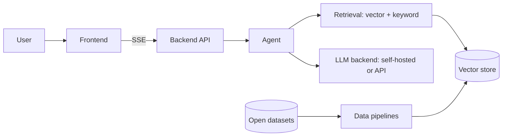

# scitech-rag-agent

[](https://github.com/Tdat10052499/scitech-rag-agent/actions/workflows/ci.yml)
[](LICENSE)


An interactive web app where an AI agent answers science and technology questions using retrieval over a large-scale corpus, and suggests relevant follow-up questions. The corpus is scoped to **large language models and NLP** research (arXiv `cs.CL`; see the [project brief](docs/00-project-brief.md)).

> Status: course project. Work runs 2026-10-13 to 2026-11-06 (release `v1.0`); the product is presented on 2026-11-10. Plan: [docs/04-roadmap.md](docs/04-roadmap.md) and [docs/plan/](docs/plan/README.md).

## What it does
1. The user asks a question about LLM/NLP research.
2. The agent rewrites the question into a standalone search query, retrieves evidence from an indexed corpus, and answers **only from that evidence, with citations**. If evidence is insufficient it says so.
3. The app proposes follow-up questions based on the answer and the retrieved context.

## Architecture in one picture

Details: [docs/01-architecture.md](docs/01-architecture.md).

## Repository map
| Path | Purpose |
|---|---|
| `pipelines/` | Ingestion, cleaning, chunking, embedding |
| `agent/` | Agent loop, retrieval orchestration, prompts, follow-up suggestions |
| `backend/` | FastAPI service exposing the API contract |
| `frontend/` | User interface |
| `evaluation/` | Golden question set, metrics, experiment reports |
| `docs/` | Brief, architecture, contracts, decisions, plan, task briefs, journals |
| `.github/` | Issue/PR templates, CI, CODEOWNERS |

## Quick start
### Run the app with one command (Docker)

Needs Docker with Compose v2. The stack runs Qdrant, the backend and the frontend; the LLM stays
outside it (`LLM_BASE_URL`, see [docs/runbooks/llm-serving.md](docs/runbooks/llm-serving.md)).

```bash
cp .env.example .env        # fill in LLM_*, EMBEDDING_MODEL, EMBEDDING_QUERY_PREFIX; never commit .env
make up                     # = docker compose up -d --build (Windows: run that command)
# open http://localhost:8080 (UI); the API is also on http://localhost:8000
make down                   # stop; the Qdrant volume and data/ are kept
```

- **Index.** A new Qdrant volume is empty. Load the vectors and build the BM25 index once with
  [docs/runbooks/data-pipeline.md](docs/runbooks/data-pipeline.md) (Qdrant on `localhost:6333`);
  the backend reads the BM25 index from `./data/index/bm25`, mounted at `/app/data`.
- **Inside the stack** `QDRANT_URL` and `DATA_DIR` are set by `docker-compose.yml`; the other
  values come from `.env`. Traces (and later feedback) are written to `./data/logs/`.
- **LLM on this machine** (Ollama): `LLM_BASE_URL=http://host.docker.internal:11434/v1`. A Kaggle
  or Colab tunnel URL works as is.
- **Without an index or LLM** (UI work): `AGENT_MODE=demo` in `.env`.
- The first start downloads the embedding model into the `hf_cache` volume; the backend reports
  healthy after its warm-up, and the frontend starts after that. Check with `make logs`.
- The frontend's nginx forwards `/chat` and `/health` to the backend, so no `CORS_ORIGINS` is needed.
  Another UI port: `FRONTEND_PORT=3000 make up`.

### Development (macOS / Linux, with `make`)

```bash
cp .env.example .env        # fill in real values; never commit .env
make setup                  # dev tooling + backend dependencies
make up-qdrant              # start only Qdrant via Docker
make run                    # backend at http://localhost:8000 (GET /health), auto-reload
make lint test
```
### Windows (PowerShell, without `make`)

`make` is not installed on Windows by default. Run the Makefile commands directly
(Python 3.10+; CI uses 3.11; a virtual environment is recommended). Tested on Windows with Python 3.11.9.

```powershell
git clone https://github.com/Tdat10052499/scitech-rag-agent.git
cd scitech-rag-agent
python -m venv .venv
.\.venv\Scripts\Activate.ps1          # if blocked: Set-ExecutionPolicy -Scope Process -ExecutionPolicy Bypass
Copy-Item .env.example .env           # fill in real values; never commit .env
python -m pip install -r requirements-dev.txt -r backend/requirements.txt -r agent/requirements.txt   # make setup
pre-commit install                    # make setup (git hooks)
ruff check .                          # make lint
python -m pytest                      # make test
$env:PYTHONPATH = "agent/src"         # the backend imports the agent package
python -m uvicorn app.main:app --app-dir backend/src --reload --port 8000   # make run
```

In a second terminal, check the backend: `Invoke-RestMethod http://localhost:8000/health` returns `status : ok`
(or open http://localhost:8000/health in a browser: `{"status":"ok"}`). Stop the server with `Ctrl+C`.
Qdrant alone needs Docker Desktop: `docker compose up -d qdrant` (`make up-qdrant`); it is not needed for `/health`.

## Working on this repo
Start with [AGENTS.md](AGENTS.md) (also the entry point for AI coding agents) and [CONTRIBUTING.md](CONTRIBUTING.md). Design decisions are recorded as ADRs in [docs/decisions/](docs/decisions/).

## Team
| Member | GitHub | Owns |
|---|---|---|
| Hồ Du Tuấn Đạt (maintainer) | [@Tdat10052499](https://github.com/Tdat10052499) | Agent, backend, contracts, LLM serving, integration |
| Nguyễn Minh Chính | [@F4ol4n](https://github.com/F4ol4n) | Data pipeline, big-data processing, index, retrieval quality |
| Dương Ngọc Linh Đan | [@Yui-Mika](https://github.com/Yui-Mika) | Frontend, evaluation, golden set, user study |

## License
Code: [MIT](LICENSE). Data keeps its source licence: arXiv metadata (titles, abstracts) is CC0 1.0; Wikipedia text is CC BY-SA 4.0 and is shown with attribution. Details: [docs/03-data-sources.md](docs/03-data-sources.md).
