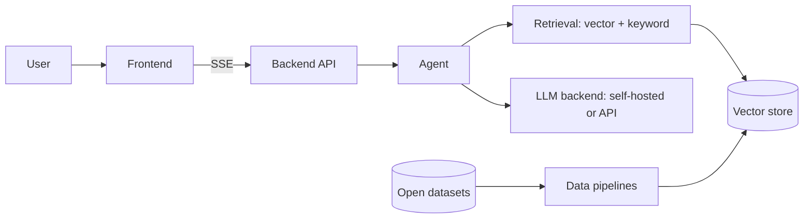

# scitech-rag-agent

[](https://github.com/Tdat10052499/scitech-rag-agent/actions/workflows/ci.yml)
[](LICENSE)


An interactive web app where an AI agent answers science and technology questions using retrieval over a large-scale corpus, and suggests relevant follow-up questions. The corpus is scoped to **large language models and NLP** research (arXiv `cs.CL` plus Wikipedia background; see the [project brief](docs/00-project-brief.md)).

> Status: course project. Work runs 2026-10-13 to 2026-11-06 (release `v1.0`); the product is presented on 2026-11-10. Plan: [docs/04-roadmap.md](docs/04-roadmap.md) and [docs/plan/](docs/plan/README.md).

## What it does
1. The user asks a question about LLM/NLP research.
2. The agent rewrites the question into a standalone search query, retrieves evidence from an indexed corpus, and answers **only from that evidence, with citations**. If evidence is insufficient it says so.
3. The app proposes follow-up questions based on the answer and the retrieved context.

## Architecture in one picture

Details: [docs/01-architecture.md](docs/01-architecture.md).

## Repository map
| Path | Purpose |
|---|---|
| `pipelines/` | Ingestion, cleaning, chunking, embedding |
| `agent/` | Agent loop, retrieval orchestration, prompts, follow-up suggestions |
| `backend/` | FastAPI service exposing the API contract |
| `frontend/` | User interface |
| `evaluation/` | Golden question set, metrics, experiment reports |
| `docs/` | Brief, architecture, contracts, decisions, plan, task briefs, journals |
| `.github/` | Issue/PR templates, CI, CODEOWNERS |

## Quick start
```bash
cp .env.example .env        # fill in real values; never commit .env
make setup                  # dev tooling + backend dependencies
make up                     # start Qdrant via Docker
make run                    # backend at http://localhost:8000 (GET /health)
make lint test
```

## Working on this repo
Start with [AGENTS.md](AGENTS.md) (also the entry point for AI coding agents) and [CONTRIBUTING.md](CONTRIBUTING.md). Design decisions are recorded as ADRs in [docs/decisions/](docs/decisions/).

## Team
| Member | GitHub | Owns |
|---|---|---|
| Hồ Du Tuấn Đạt (maintainer) | [@Tdat10052499](https://github.com/Tdat10052499) | Agent, backend, contracts, LLM serving, integration |
| Faolan | [@F4ol4n](https://github.com/F4ol4n) | Data pipeline, big-data processing, index, retrieval quality |
| Duong Ngoc Linh Dan | [@Yui-Mika](https://github.com/Yui-Mika) | Frontend, evaluation, golden set, user study |

## License
Code: [MIT](LICENSE). Data keeps its source licence: arXiv metadata (titles, abstracts) is CC0 1.0; Wikipedia text is CC BY-SA 4.0 and is shown with attribution. Details: [docs/03-data-sources.md](docs/03-data-sources.md).
