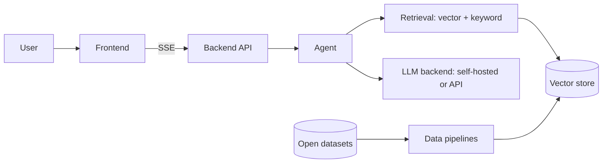

# scitech-rag-agent

[](https://github.com/Tdat10052499/scitech-rag-agent/actions/workflows/ci.yml)
[](LICENSE)


An interactive web app where an AI agent answers science and technology questions using retrieval over a large-scale corpus, and suggests relevant follow-up questions. The corpus is scoped to **large language models and NLP** research (arXiv `cs.CL`; see the [project brief](docs/00-project-brief.md)).

> Status (2026-11-02): course project, feature freeze since 2026-10-30 (tag `v0.6-rc`); the final evaluation runs are done (Week 7). Work runs 2026-10-13 to 2026-11-06 (release `v1.0`); the product is presented on 2026-11-10. Plan: [docs/04-roadmap.md](docs/04-roadmap.md) and [docs/plan/](docs/plan/README.md).

**Live demo:** https://teichi-scitech-rag-agent.hf.space (Hugging Face Space, deployed from `main`). The public copy uses a hosted LLM (`qwen/qwen3.8-27b` on Groq) and a free API quota, so it accepts about 2 questions per minute in total and 3 per visitor; the evaluation numbers below are for `llama3.2:3b` on a laptop GPU and do not describe the Space. Details: [docs/runbooks/hosting.md](docs/runbooks/hosting.md).

## What it does
1. The user asks a question about LLM/NLP research.
2. The agent rewrites the question into a standalone search query, retrieves evidence from an indexed corpus, and answers **only from that evidence, with citations**. If evidence is insufficient it says so.
3. The app proposes follow-up questions based on the answer and the retrieved context.

| Part | What is used |
|---|---|
| Corpus | 121,860 arXiv `cs.CL` papers (titles and abstracts, CC0) from the Kaggle snapshot, 121,926 chunks; frozen index for the evaluation ([evaluation/SNAPSHOT.md](evaluation/SNAPSHOT.md)) |
| Retrieval | hybrid: dense (`BAAI/bge-small-en-v1.5`, Qdrant) + BM25, fused with reciprocal rank fusion; top 5 passages ([ADR 0009](docs/decisions/0009-default-retrieval.md)) |
| Generation | any OpenAI-compatible endpoint ([ADR 0001](docs/decisions/0001-hybrid-llm-backend.md)); evaluated with `llama3.2:3b` on Ollama ([ADR 0006](docs/decisions/0006-llm-model.md)) |
| Agent | query rewrite for follow-up turns, answer with `[n]` citations, refusal when the sources do not answer, follow-up suggestions |
| Interface | React chat with a sources panel, citation markers, refusal state and answer rating ([frontend/](frontend/)) |

## Results (Week 7, 2026-11-02)
Measured on the 65-item golden set (60 answerable, 5 unanswerable) with the frozen index; full log in [evaluation/RUNS.md](evaluation/RUNS.md) §7.

| Question | Result |
|---|---|
| Retrieval (R1–R3, n = 60) | recall@5 hybrid 0.508, dense 0.458, BM25 0.508; recall@10 0.583 / 0.492 / 0.567. Only hybrid > dense at recall@10 is significant (+0.092, 95% CI [0.025, 0.167]) |
| Faithfulness (A1 MVP / A2 + rewrite) | 0.491 [0.39, 0.59] / 0.527 [0.43, 0.62]; answerable questions refused 6/60 and 5/60; unanswerable refused 4/5 |
| Answer relevance (1–3, LLM judge) | A1 2.31 [2.11, 2.52], A2 2.44 [2.24, 2.62] |
| Evidence self-check (A3, A4) | refused 60/60 answerable questions with the 3B model, so it is off in the product |
| Latency (laptop, 30 questions) | first token p50 0.42 s; answer complete p50 1.3 s, p95 3.2 s ([docs/runbooks/performance.md](docs/runbooks/performance.md)) |

Faithfulness and relevance are rated by an LLM judge (`qwen2.5:7b`) and checked by hand on a 20% sample; the samples are small and most intervals overlap. Error analyses: [answers](evaluation/reports/answer-errors-w7.md), [retrieval](evaluation/reports/retrieval-errors-w7.md).

## Architecture in one picture

Details: [docs/01-architecture.md](docs/01-architecture.md).

## Repository map
| Path | Purpose |
|---|---|
| `pipelines/` | Ingestion, cleaning, chunking, embedding |
| `agent/` | Agent loop, retrieval orchestration, prompts, follow-up suggestions |
| `backend/` | FastAPI service exposing the API contract |
| `frontend/` | User interface |
| `evaluation/` | Golden question set, metrics, experiment reports |
| `deploy/` | Public demo on a Hugging Face Docker Space ([runbook](docs/runbooks/hosting.md)); `.github/workflows/deploy-hf-space.yml` uploads `main` after CI passes |
| `notebooks/` | Kaggle notebooks for the data and embedding runs (outputs stripped) |
| `data/` | Local data, indexes and logs; git-ignored |
| `docs/` | Brief, architecture, contracts, decisions, plan, task briefs, journals |
| `.github/` | Issue/PR templates, CI, CODEOWNERS |

## Quick start

To only try the app, use the [live demo](https://teichi-scitech-rag-agent.hf.space). To run it yourself:

### Run the app with one command (Docker)

Needs Docker with Compose v2. The stack runs Qdrant, the backend and the frontend; the LLM stays
outside it (`LLM_BASE_URL`, see [docs/runbooks/llm-serving.md](docs/runbooks/llm-serving.md)).

```bash
cp .env.example .env        # fill in LLM_*, EMBEDDING_MODEL, EMBEDDING_QUERY_PREFIX; never commit .env
make up                     # = docker compose up -d --build (Windows: run that command)
# open http://localhost:8080 (UI); the API is also on http://localhost:8000
make down                   # stop; the Qdrant volume and data/ are kept
```

- **Index.** A new Qdrant volume is empty. Load the vectors and build the BM25 index once with
  [docs/runbooks/data-pipeline.md](docs/runbooks/data-pipeline.md) (Qdrant on `localhost:6333`);
  the backend reads the BM25 index from `./data/index/bm25`, mounted at `/app/data`.
- **Inside the stack** `QDRANT_URL` and `DATA_DIR` are set by `docker-compose.yml`; the other
  values come from `.env`. Traces (and later feedback) are written to `./data/logs/`. Keep
  `BM25_INDEX_DIR` and `AGENT_TRACES` empty or relative to the repository root under `data/`
  (for example `data/logs/study.jsonl`): an absolute host path such as `C:\...` does not exist
  in the container.
- **Changing `.env`:** a shell variable (`$env:AGENT_TRACES=...`) does not reach the container;
  put it in `.env` and recreate the backend with `docker compose up -d backend`
  (`docker compose restart backend` keeps the old values).
- **LLM on this machine** (Ollama): `LLM_BASE_URL=http://host.docker.internal:11434/v1`. A Kaggle
  or Colab tunnel URL works as is.
- **Without an index or LLM** (UI work): `AGENT_MODE=demo` in `.env`.
- The first start downloads the embedding model into the `hf_cache` volume; the backend reports
  healthy after its warm-up, and the frontend starts after that. Check with `make logs`.
- The frontend's nginx forwards `/chat` and `/health` to the backend, so no `CORS_ORIGINS` is needed.
  Another UI port: `FRONTEND_PORT=3000 make up`.

### Development (macOS / Linux, with `make`)

```bash
cp .env.example .env        # fill in real values; never commit .env
make setup                  # dev tooling + backend dependencies
make up-qdrant              # start only Qdrant via Docker
make run                    # backend at http://localhost:8000 (GET /health), auto-reload
make lint test
```
### Windows (PowerShell, without `make`)

`make` is not installed on Windows by default. Run the Makefile commands directly
(Python 3.10+; CI uses 3.11; a virtual environment is recommended). Tested on Windows with Python 3.11.9;
the clean-clone check of 2026-10-30 (W8-D2-DAT-1) also installed and ran everything below on Python 3.15.
Every new PowerShell window needs `.\.venv\Scripts\Activate.ps1` again; without it `python` is the
system interpreter and reports `No module named uvicorn`.

```powershell
git clone https://github.com/Tdat10052499/scitech-rag-agent.git
cd scitech-rag-agent
python -m venv .venv
.\.venv\Scripts\Activate.ps1          # if blocked: Set-ExecutionPolicy -Scope Process -ExecutionPolicy Bypass
Copy-Item .env.example .env           # fill in real values; never commit .env
python -m pip install -r requirements-dev.txt -r backend/requirements.txt -r agent/requirements.txt   # make setup
pre-commit install                    # make setup (git hooks)
ruff check .                          # make lint
python -m pytest                      # make test
$env:PYTHONPATH = "agent/src"         # the backend imports the agent package
python -m uvicorn app.main:app --app-dir backend/src --reload --port 8000   # make run
```

In a second terminal, check the backend: `Invoke-RestMethod http://localhost:8000/health` returns `status : ok`
(or open http://localhost:8000/health in a browser: `{"status":"ok"}`). Stop the server with `Ctrl+C`.
Qdrant alone needs Docker Desktop: `docker compose up -d qdrant` (`make up-qdrant`); it is not needed for `/health`.

#### Run the real app on Windows without Docker

`/health` works without an index or an LLM, but `/chat` in the default `AGENT_MODE=real` needs all
of the following. Without them the UI shows "The answer service is unavailable" and the backend
log says why (`cannot build the agent ...`).

1. **Ollama** with the generator: `ollama pull llama3.2:3b`.
2. **Qdrant 1.19.2**, either `docker compose up -d qdrant` or the native Windows binary from the
   Qdrant releases page, started in its own window **from the same folder every time** (it keeps
   its data in `./storage` of the current folder). The collection `scitech_chunks` must hold the
   index: build and load it with [docs/runbooks/data-pipeline.md](docs/runbooks/data-pipeline.md)
   (`clean` needs Java 17, so WSL2, Linux or Kaggle), or restore a teammate's Qdrant storage.
   Check: the count below must be 121926 for the evaluated index (`evaluation/SNAPSHOT.md`).
3. **BM25 index** in `data\index\bm25` (`postings.npz` and `_bm25_manifest.json`), built from the
   same chunks (runbook section 2) or copied from the machine that built them.
4. **Embedding dependencies** (sentence-transformers and PyTorch, several GB), not part of
   `make setup`: `python -m pip install -r agent/requirements-embed.txt`.
5. **`.env` values in the shell.** The Python code does not read `.env` (only Docker Compose
   does), so load it into each PowerShell window that runs the backend.

```powershell
.\.venv\Scripts\Activate.ps1
Get-Content .env | Where-Object { $_ -match "^[A-Z_]+=" } | ForEach-Object { $k, $v = $_ -split "=", 2; Set-Item "env:$k" $v }
$env:PYTHONPATH = "agent/src"
(Invoke-RestMethod -Method Post -Uri http://127.0.0.1:6333/collections/scitech_chunks/points/count -ContentType application/json -Body '{"exact": true}').result.count
python -m uvicorn app.main:app --app-dir backend/src --port 8000
```

The first question loads the embedding model (downloaded once into the Hugging Face cache). Then the UI, in a
second window with Node 22:

```powershell
cd frontend
npm install
$env:VITE_BACKEND_URL = "http://127.0.0.1:8000"
npm run dev                            # open http://localhost:5173
```

## Working on this repo
Start with [AGENTS.md](AGENTS.md) (also the entry point for AI coding agents) and [CONTRIBUTING.md](CONTRIBUTING.md). Design decisions are recorded as ADRs in [docs/decisions/](docs/decisions/).

## Team
| Member | GitHub | Owns |
|---|---|---|
| Hồ Du Tuấn Đạt (maintainer) | [@Tdat10052499](https://github.com/Tdat10052499) | Agent, backend, contracts, LLM serving, integration |
| Nguyễn Minh Chính | [@F4ol4n](https://github.com/F4ol4n) | Data pipeline, big-data processing, index, retrieval quality |
| Dương Ngọc Linh Đan | [@Yui-Mika](https://github.com/Yui-Mika) | Frontend, evaluation, golden set, user study |

## License
Code: [MIT](LICENSE). Data keeps its source licence: arXiv metadata (titles, abstracts) is CC0 1.0. Wikipedia pages (CC BY-SA 4.0) were downloaded but are not in the v1.0 index (ADR 0003 update, #34). Details: [docs/03-data-sources.md](docs/03-data-sources.md).
