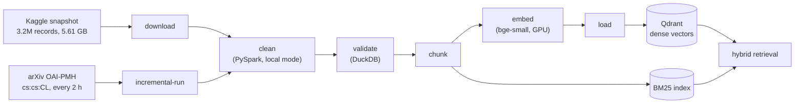
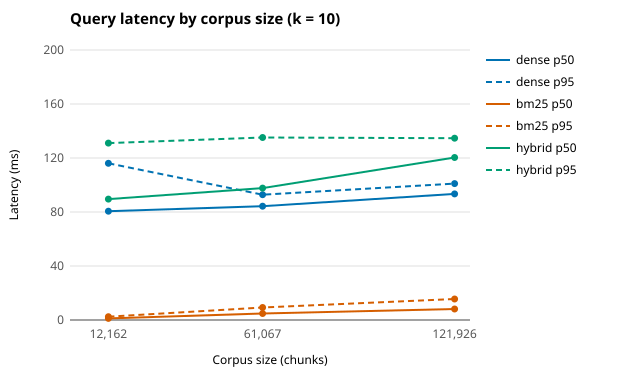

# 2. Data

<!-- W7-D4-FAO-1 and W8-D1-FAO-1: final numbers as of Gate W7 (2026-11-03), tightened to the
5-page budget of docs/report/00-outline.md. Every number cites the file or run it comes from.
Open items are marked TODO with the task that fills them. -->

This chapter describes the corpus behind the agent: its sources and licences, its size, the
pipeline that indexes it, the processing engine, how new papers are added, and how the index
behaves as the corpus grows.

## 2.1 Sources and licences

The sub-domain is LLM/NLP research. The corpus is **every arXiv record whose categories contain
`cs.CL`**, as primary category or cross-list, from all years, using titles and abstracts only
(ADR 0003).

| Source | Role | Access | Licence |
|---|---|---|---|
| arXiv metadata | the whole index | bulk: Kaggle snapshot `Cornell-University/arxiv`, version 307 (2026-10-10); daily: OAI-PMH, set `cs:cs:CL` | CC0 1.0 for titles, abstracts and other descriptive metadata |
| Wikipedia (English, NLP categories) | background articles, downloaded but cut from the v1.0 index (ADR 0003 update, #34) | MediaWiki API, 1,186 pages listed, 1,169 with text | CC BY-SA 4.0 |
| OpenAlex | optional enrichment by DOI; not used in v1.0 | REST API | CC0 1.0 |

Sources: `docs/03-data-sources.md`, ADR 0003.

Full-text PDFs are not indexed: their licences are the authors' own, while the metadata is public
domain. After the freeze, ADR 0012 lets the agent read one paper's HTML full text on demand when a
question names its arXiv id; the text stays in memory and is never added to the index. Every chunk carries a `license` field (`CC0-1.0`), the interface links each source to its
arXiv page, and `incremental-fetch` keeps arXiv's limit of one OAI-PMH request every 3 seconds.

## 2.2 Volume

| Item | Value | Source |
|---|---:|---|
| Raw snapshot, all of arXiv | 3,205,432 records, 5.61 GB of JSON Lines | `pipelines/reports/data_profile.md` §1 |
| Records with `cs.CL` | 121,860 (233 MB of metadata) | data profile §1, `docs/03-data-sources.md` |
| of which cross-listed from another primary category | 32,299 (26.5%) | data profile §5 |
| Records after cleaning | 121,860 (0 dropped, 0 duplicates) | data profile §2 |
| Cleaned Parquet | 95.0 MB in 33 files (59 : 1 against the raw snapshot) | data profile §1 |
| Chunks | 121,926 (121,794 papers with 1 chunk, 66 with 2) | FAO journal W3, D07 |
| Vectors | 121,926 × 384 float32 (`BAAI/bge-small-en-v1.5`), 198 MB | ADR 0007, FAO journal W3 |
| Qdrant collection | 609.9 MiB on disk | `pipelines/reports/index_profile.md` (#68) |
| BM25 index | 177.2 MiB on disk | index profile (#68) |

The corpus grows fast at the recent end: 13,603 records in 2023, 20,689 in 2024, 23,762 in 2025
and 22,589 in 2026 up to 2026-10-10, so papers from 2023 on are 66% of it (data profile §4). A
median abstract has 164 words (p95 246, max 491; §6), so almost every abstract fits one chunk.

**Two tiers.** Every rebuild processes the whole snapshot (3.2 million records, 5.61 GB) and
indexes only `cs.CL` (233 MB). This filter is the "big data" part of the pipeline (ADR 0003,
option B).

## 2.3 Pipeline

<!-- TODO(W8-D4-LDN-1): mermaid does not render in every PDF exporter; export this diagram as an
image if the PDF shows the code. -->

Each step is a re-runnable command of `python -m scitech_pipelines` that reads and writes files
under `data/` and records its counts in a manifest; `run-all` chains them (`pipelines/AGENTS.md`).

| Step | What it does | Time (full corpus) | Where |
|---|---|---:|---|
| download | Kaggle zip, extraction, SHA-256 | 150 s | any machine |
| clean | filter `cs.CL`, normalise fields, drop records without title, abstract or date, de-duplicate by `doc_id`; DuckDB recounts the category and a mismatch fails the run | 82-111 s, peak 2.9 GB | Java 17+ (Kaggle CPU notebook) |
| validate | 13 checks: schema, ids, dates, category, licence, count against the clean manifest, golden documents present | under 1 s | any machine |
| chunk | `title. abstract`, windows of at most 320 words overlapping by 48 | 14.1 s | any machine |
| embed | sentence-transformers, L2-normalised float32, resumable parts | 14.4 min on a T4 | GPU notebook |
| load | upsert into Qdrant, ids `uuid5(chunk_id)`, exact count check | 135.2 s | where Qdrant runs |
| BM25 build | Okapi BM25 over chunk text | 36.7 s | any machine |

Times: `docs/runbooks/data-pipeline.md` (measured times), data profile §3, ADR 0007, index profile
(#68).

Design choices:
- **Counts must chain:** 121,860 documents → 121,926 chunks → 121,926 vectors → 121,926 points.
  A step fails if its output does not match; the load needs exactly one point per chunk.
- **Resumable:** `embed` and `load` write in parts and resume at the first missing part. A change
  of model, chunking or collection needs `--force`, so vectors of two settings are never mixed.
- **Chunking by words** (the chunker ran before the model was chosen): only 82 of 121,926 chunks
  (0.067%) exceed the model's 512 tokens, below the 0.1% threshold set in advance (ADR 0007).
- **Embedding model:** a rule written before the run required `bge-base-en-v1.5` to find 2 more of
  30 questions at recall@5 than `bge-small-en-v1.5`. It found 1.0 more (0.317 against 0.283), so
  the smaller and faster model was chosen. ADR 0007 calls this evidence weak: the intervals
  overlap almost completely.

## 2.4 Processing engine (ADR 0005)

The brief prefers PySpark if a measurement shows it is workable, because this is a Big Data
course. The same job (read the JSON Lines, keep `cs.CL`, write Parquet, count by year) was timed in
three engines.

| Engine, full real snapshot (5.61 GB), Kaggle notebook, 4 CPUs | Wall time | Peak memory |
|---|---:|---:|
| DuckDB | 16.3 s | 1.2 GB |
| PySpark 4.0.4, local mode | 79.5 s | 3.3 GB |
| Polars (eager reader) | not run: about 30-35 GB extrapolated | |

Source: ADR 0005, table C. Polars' figure is an extrapolation from a 0.3 GB slice.

Both engines kept the same 121,860 records with the same per-year counts. DuckDB is about five
times faster, but PySpark runs `clean`: 80 s does not matter for a job that runs a few times, and
its DataFrame code runs unchanged on a cluster. DuckDB does the checks (the recount inside `clean`,
`validate`, the profile and the chunker). The cost is Java 17+, so `clean` runs in a Kaggle CPU
notebook or WSL2.

## 2.5 Incremental ingestion (ADR 0008)

New papers arrive every weekday: about 460 per week in 2025 (ADR 0003) and about 730 per week in
the October 2026 live test (1,782 new papers in 17 days, #124). Downloading the 5.61 GB snapshot
again for a few hundred records a day makes no sense, so `incremental-run` (#76) adds them:

1. **Fetch** the records changed since a date watermark from arXiv's OAI-PMH set `cs:cs:CL`, which
   holds every `cs.CL` id, cross-lists included (live check, 2026-10-17).
2. **Process** them with the same `clean`, `chunk` and `embed` code as the bulk load.
3. **Replace** each fetched paper: delete its points, then load its new chunks. A third of a day's
   records are new versions of indexed papers (89 of 276 on 2026-10-16), and a shorter abstract
   must not leave old chunks behind.
4. **Move the watermark** only after the load and its count check pass, so a failed run repeats
   the same range, and a repeated range replaces the same points.

**Live test** (W5-D4-FAO-1, 2026-10-27; `pipelines/reports/incremental_test.md`, #124). The whole
command ran twice in a Kaggle CPU notebook against a copy of the full index:

| | First run | Same day again |
|---|---:|---:|
| Range | 2026-10-10 to 2026-10-26 | 2026-10-26 |
| Papers fetched / chunks | 2,744 / 2,758 | 177 / 178 |
| Papers already indexed (old points deleted) | 962 (966) | 177 (178) |
| Points before -> after | 121,926 -> 123,718 | 123,718 -> 123,718 |
| Duplicate, stale or missing chunks | 0 | 0 |
| Wall time (of which embedding on CPU) | 10 min 45 s (549 s) | 1 min 13 s (39 s) |

The index grew by exactly the chunks of the 1,782 new papers, every reloaded paper kept only its
new chunks, and repeating the last day changed nothing; a check of the whole collection against
each run's chunks confirmed this, independently of the load's own count. Embedding is 85% of the
time, so a day of a few hundred papers takes about a minute on a CPU.

**Scheduling** (ADR 0011, replacing ADR 0008 point 6). The course asks for near-real-time data, so
an `ingest` container next to Qdrant runs `incremental-run` every 2 hours (`INGEST_EVERY_HOURS=2`)
with its own Java 17. Each run:

- fetches up to today (UTC), so a record is picked up within 2 hours of its OAI-PMH datestamp;
- processes only the ids whose `(id, datestamp)` changed, and stops with "nothing changed" when
  none did, which is most runs;
- takes a lock, so two runs never overlap;
- after a successful load, rebuilds BM25 into a new directory and switches to it atomically; the
  backend reloads it (`BM25_RELOAD_SECONDS`), so both halves of hybrid search see new papers (#119).

The schedule writes only to a separate serving index (`scitech_chunks_live`, `data/index/bm25-live`)
and refuses the frozen collection, so the evaluation index of §2.7 never changes. arXiv announces
new papers once a day, so freshness is "within 2 hours of the announcement". The code is built on a
branch during Week 7 (#152, #155) and merged only after Gate W7, so no evaluation run sees it.

<!-- TODO(W8-D6-FAO-1): soak result from D20 to D22: runs logged in data/logs/incremental.log,
failed or overlapping runs, papers added, time per run, BM25 switch. If the soak fails, ADR 0011
falls back to the manual command; rewrite this paragraph then. -->

Known limits: deleted records stay until the next full rebuild, a replaced paper has no points for
0.3 to 2.4 s during its load, and the schedule runs only while the serving laptop is awake (#119).

## 2.6 Scaling

The index was built at 10%, 50% and 100% of the corpus, with nested subsets taken by a hash of
`doc_id` and the vectors already computed (`pipelines/reports/scaling.md`, #96). Each size answered
the same 100 queries at k = 10 on FAO's laptop (Qdrant 1.19.2 in Docker, exact search).

| Size | Chunks | Load (s) | BM25 build (s) | dense p50 / p95 (ms) | bm25 p50 / p95 (ms) | hybrid p50 / p95 (ms) |
|---|---:|---:|---:|---:|---:|---:|
| 10% | 12,162 | 18.2 | 1.8 | 80.6 / 116.1 | 1.2 / 2.5 | 89.6 / 131.0 |
| 50% | 61,067 | 51.3 | 9.8 | 84.3 / 92.8 | 4.8 / 9.2 | 97.7 / 135.2 |
| 100% | 121,926 | 135.2 | 36.7 | 93.4 / 101.0 | 8.1 / 15.5 | 120.4 / 134.6 |

<!-- Charts: pipelines/scripts/scaling_charts.py (#121). -->

- **BM25 grows with the corpus:** p50 1.2, 4.8 and 8.1 ms, in step with the chunk count.
- **Dense latency is mostly fixed costs:** query embedding on the CPU (p50 38 to 63 ms) and the
  round trip to Qdrant in Docker (about 46 ms). Only the vector search depends on the corpus.
- **Vector search alone** (query vectors computed beforehand; `scaling.md` §2.1, #121), p50 inside
  Qdrant: exact search 2.0, 8.0 and 14.4 ms, about 1.1 ms per 10,000 points; HNSW 1.6 to 2.6 ms
  at every size, with 97.9% to 100% of the exact top 10. At a million chunks exact search would
  take about 110 ms (extrapolated), so HNSW would then be the better choice (#87).
- **Retrieval is not the bottleneck:** hybrid stays under 135 ms at p95 at every size, far below
  the LLM's first token (p50 0.42 s on the Week 7 host; `docs/runbooks/performance.md`, #161).

All sizes were cut from the frozen index of §2.7. Limits: one machine and one run of 100
sequential queries per size, so differences of a few milliseconds are noise; memory was measured
for the whole Qdrant container; the 100% load and BM25 times come from the full load of 2026-10-21.

## 2.7 Frozen snapshot for evaluation

Every evaluation run uses one index, recorded in `evaluation/SNAPSHOT.md` (W6-D4-FAO-1):

| Item | Value |
|---|---|
| Snapshot id | `scitech_chunks/bge-small-en-v1.5/chunked-2026-10-17T05:19:12/embedded-2026-10-17T06:40:37` |
| Dataset | Kaggle arXiv version 307 (2026-10-10), `cs.CL` |
| Documents / chunks / points | 121,860 / 121,926 / 121,926 |
| Embedding model | `BAAI/bge-small-en-v1.5`, 384 dimensions, cosine, query prefix only |
| Search | Qdrant 1.19.2, exact search; BM25 over the same chunks |

Every evaluation run records this id, so runs on different indexes cannot be compared by mistake.
Incremental loads never write to the collection: the live test ran on a copy, and the schedule
refuses it (ADR 0011). Checks against the file:
- 2026-10-27, FAO's laptop: same id, 121,926 points, all 57 relevant documents of the golden set
  present;
- 2026-10-30, after the feature freeze: 121,926 points on both serving machines, FAO's laptop (the
  user-study host, #146) and DAT's laptop (the Week 7 host, which also matched the id and the BM25
  `chunked_at`; `evaluation/SNAPSHOT.md` §1, #164);
- 2026-10-31, final golden set (65 items: 60 answerable, 5 unanswerable; #168): all 78 relevant
  documents in the chunks and in Qdrant (W7-D1-FAO-1, #156).
