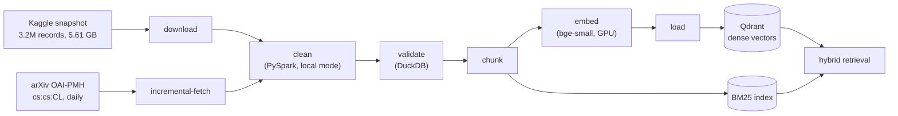
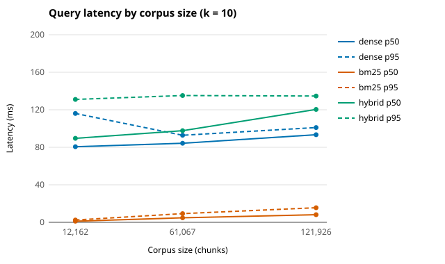

# 2. Data

<!-- Draft (W7-D4-FAO-1, written early on D13). Every number cites the file or run it comes from.
Open items are marked TODO with the task that fills them. Page budget: set by the outline
(docs/report/00-outline.md, W7-D5-DAT-1); trim in W8-D1-FAO-1. -->

This chapter describes the corpus behind the agent: where it comes from and under which licence,
how large it is, how the pipeline turns it into a searchable index, why the processing engine is
PySpark, how new papers are added, and how the index behaves as the corpus grows.

## 2.1 Sources and licences

The sub-domain is LLM/NLP research. The corpus is **every arXiv record whose categories contain
`cs.CL`**, as primary category or cross-list, from all years, using titles and abstracts only
(ADR 0003).

| Source | Role | Access | Licence |
|---|---|---|---|
| arXiv metadata | the whole index | bulk: Kaggle snapshot `Cornell-University/arxiv`, version 307 (2026-10-10); daily: OAI-PMH, set `cs:cs:CL` | CC0 1.0 for titles, abstracts and other descriptive metadata |
| Wikipedia (English, NLP categories) | background articles, downloaded but cut from the v1.0 index (ADR 0003 update, #34) | MediaWiki API, 1,186 pages listed, 1,169 with text | CC BY-SA 4.0 |
| OpenAlex | optional enrichment by DOI; not used in v1.0 | REST API | CC0 1.0 |

Sources: `docs/03-data-sources.md`, ADR 0003.

Full-text PDFs are out of scope: their licences are the authors' own, while the metadata is
public domain. Every chunk carries a `license` field (`CC0-1.0`), and the interface links each
source to its arXiv abstract page. The pipeline respects arXiv's limit of one request every
3 seconds for OAI-PMH (`incremental-fetch` refuses a shorter pause).

## 2.2 Volume

| Item | Value | Source |
|---|---:|---|
| Raw snapshot, all of arXiv | 3,205,432 records, 5.61 GB of JSON Lines | `pipelines/reports/data_profile.md` §1 |
| Records with `cs.CL` | 121,860 (233 MB of metadata) | data profile §1, `docs/03-data-sources.md` |
| of which cross-listed from another primary category | 32,299 (26.5%) | data profile §5 |
| Records after cleaning | 121,860 (0 dropped, 0 duplicates) | data profile §2 |
| Cleaned Parquet | 95.0 MB in 33 files (59 : 1 against the raw snapshot) | data profile §1 |
| Chunks | 121,926 (121,794 papers with 1 chunk, 66 with 2) | FAO journal W3, D07 |
| Vectors | 121,926 × 384 float32 (`BAAI/bge-small-en-v1.5`), 198 MB | ADR 0007, FAO journal W3 |
| Qdrant collection | 609.9 MiB on disk | `pipelines/reports/index_profile.md` (#68) |
| BM25 index | 177.2 MiB on disk | index profile (#68) |

The corpus grows fast at the recent end: 13,603 records in 2023, 20,689 in 2024, 23,762 in 2025
and 22,589 in 2026 up to 2026-10-10 (data profile §4). Papers from 2023 on are 66% of the corpus.
A median abstract has 164 words (p95 246, max 491; data profile §6), so almost every abstract fits
one chunk.

**Two tiers.** The processing tier reads the whole snapshot on every rebuild (3.2 million records),
and the index tier holds only `cs.CL`. This is the "big data" part of the pipeline: the job filters
5.61 GB down to 233 MB before anything is embedded (ADR 0003, option B).

## 2.3 Pipeline

<!-- TODO(W8-D4-LDN-1): mermaid does not render in every PDF exporter; export this diagram as an
image if the PDF shows the code. -->

Each step is a command of `python -m scitech_pipelines` that reads and writes files under
`data/`, writes a manifest of its counts, and can be re-run (`pipelines/AGENTS.md`). `run-all`
chains them; each step runs as its own process and logs to `data/logs/`.

| Step | What it does | Time (full corpus) | Where |
|---|---|---:|---|
| download | Kaggle zip, extraction, SHA-256 | 150 s | any machine |
| clean | filter `cs.CL`, normalise fields, drop records without title, abstract or date, de-duplicate by `doc_id`; DuckDB recounts the category and a mismatch fails the run | 82-111 s, peak 2.9 GB | Java 17+ (Kaggle CPU notebook) |
| validate | 13 checks: schema, ids, dates, category, licence, count against the clean manifest, golden documents present | under 1 s | any machine |
| chunk | `title. abstract`, windows of at most 320 words overlapping by 48 | 14.1 s | any machine |
| embed | sentence-transformers, L2-normalised float32, resumable parts | 14.4 min on a T4 | GPU notebook |
| load | upsert into Qdrant, ids `uuid5(chunk_id)`, exact count check | 135.2 s | where Qdrant runs |
| BM25 build | Okapi BM25 over chunk text | 36.7 s | any machine |

Times: `pipelines/README.md` (#60), data profile §3, ADR 0007, index profile (#68).

Design choices:
- **Counts must chain.** The manifests carry the counts from step to step (121,860 documents →
  121,926 chunks → 121,926 vectors → 121,926 points), and each step fails if its output does not
  match. The load, for example, refuses to finish unless the collection holds exactly one point
  per chunk.
- **Re-runnable and resumable.** `embed` and `load` write in parts and resume after a crash at the
  first missing part. A change of model, chunking or collection needs `--force`, so vectors from two
  settings are never mixed.
- **Chunking by words.** Chunk lengths are counted in words because the chunker ran before the
  embedding model was chosen (ADR 0007). Only 82 of 121,926 chunks (0.067%) exceed the model's 512
  tokens, below the 0.1% threshold set in advance, so nothing was re-chunked.
- **Embedding model.** `bge-small-en-v1.5` against `bge-base-en-v1.5` was decided by a rule written
  before the run: bge-base needed 2 more questions in recall@5 out of 30. It had 1.0 more (0.317 against
  0.283), so the smaller model was chosen, with half the memory and faster query encoding. The
  evidence is weak, as ADR 0007 states: the intervals overlap almost completely.

## 2.4 Processing engine (ADR 0005)

The brief prefers PySpark if a measurement shows it is workable, because this is a Big Data
course. The same job (read the JSON Lines, keep `cs.CL`, write Parquet, count by year) was timed in
three engines.

| Engine, full real snapshot (5.61 GB), Kaggle notebook, 4 CPUs | Wall time | Peak memory |
|---|---:|---:|
| DuckDB | 16.3 s | 1.2 GB |
| PySpark 4.0.4, local mode | 79.5 s | 3.3 GB |
| Polars (eager reader) | not run: about 30-35 GB extrapolated | |

Source: ADR 0005, table C. Polars' figure is an extrapolation from a 0.3 GB slice.

Both engines kept the same 121,860 records with the same per-year counts. DuckDB is about five
times faster, but PySpark is chosen for `clean`. Its 80 s is no problem for a job that runs a few
times, and its DataFrame API runs unchanged on a cluster. DuckDB does the checks: the recount
inside `clean`, `validate`, the profile and the chunker. The cost is that `clean` needs Java 17+, so it
runs in a Kaggle CPU notebook or WSL2, not on Windows directly.

## 2.5 Incremental ingestion (ADR 0008)

New papers arrive every weekday. The bulk index is a snapshot of 2026-10-10. Rebuilding from a
newer snapshot would mean downloading 5.61 GB again for a few hundred new records a day, so new
records are fetched incrementally instead:

1. **Fetch** the records changed since a date watermark from arXiv's OAI-PMH service (set
   `cs:cs:CL`, which a live check on 2026-10-17 showed holds every `cs.CL` id, cross-lists included).
2. **Process** them with the same `clean`, `chunk` and `embed` code as the bulk load, so
   normalisation exists only once.
3. **Replace** each fetched paper in the index. Delete all its points, then load its new chunks.
   A third of a day's records are papers already indexed that got a new version (89 of 276 on the
   live day of 2026-10-16), and a shorter new abstract must not leave old chunks behind.
4. **Move the watermark** only after the load and its count check pass. A failure at any step
   leaves the watermark, so the next run repeats the same range. Re-running a range replaces the
   same points instead of adding new ones.

One real day (2026-10-16) went through fetch, clean, validate and chunk: 276 records in one
request, 0 dropped, all 13 checks passed (ADR 0008, live day). The whole run, with the watermark,
is `incremental-run` (W5-D2-FAO-1, #76).

**Live test** (W5-D4-FAO-1, 2026-10-27; `pipelines/reports/incremental_test.md`, #124). The whole
command ran twice in a Kaggle CPU notebook against a copy of the full index:

| | First run | Same day again |
|---|---:|---:|
| Range | 2026-10-10 to 2026-10-26 | 2026-10-26 |
| Papers fetched / chunks | 2,744 / 2,758 | 177 / 178 |
| Papers already indexed (old points deleted) | 962 (966) | 177 (178) |
| Points before -> after | 121,926 -> 123,718 | 123,718 -> 123,718 |
| Duplicate, stale or missing chunks | 0 | 0 |
| Wall time (of which embedding on CPU) | 10 min 45 s (549 s) | 1 min 13 s (39 s) |

The index grew by exactly the chunks of the 1,782 new papers, every reloaded paper kept only its
new chunks, and repeating the last day changed nothing. Each run was checked by comparing the whole
collection before and after with the run's chunks, independently of the load's own count check.
Embedding is 85% of the time; a single day of a few hundred papers takes about a minute on a CPU.

**Scheduling** (ADR 0008, point 6): for v1.0 the update is one manual command run on demand. The
machine that serves the demo has no Java 17 for Spark, a Kaggle notebook cannot reach its Qdrant,
and the index is frozen for evaluation from W6-D4 until the final gate anyway. One run catches up
all missed days in a single range. On a machine with Java 17+ the daily schedule is one cron line
(recorded in the ADR, not tested).

Known limits: deleted records stay in the index until the next full rebuild, and the BM25 index
is not yet rebuilt with incremental chunks (#119).

## 2.6 Scaling

To show how the index behaves as the corpus grows, the same index was built at 10%, 50% and 100%
of the corpus. The subsets were taken by a hash of `doc_id`, so they are nested and spread over all
years, and they reuse the vectors already computed (`pipelines/reports/scaling.md`, #96). Each size
answered the same 100 queries at k = 10, on FAO's laptop with Qdrant 1.19.2 in Docker and exact
search.

| Size | Chunks | Load (s) | BM25 build (s) | dense p50 / p95 (ms) | bm25 p50 / p95 (ms) | hybrid p50 / p95 (ms) |
|---|---:|---:|---:|---:|---:|---:|
| 10% | 12,162 | 18.2 | 1.8 | 80.6 / 116.1 | 1.2 / 2.5 | 89.6 / 131.0 |
| 50% | 61,067 | 51.3 | 9.8 | 84.3 / 92.8 | 4.8 / 9.2 | 97.7 / 135.2 |
| 100% | 121,926 | 135.2 | 36.7 | 93.4 / 101.0 | 8.1 / 15.5 | 120.4 / 134.6 |

<!-- Charts: pipelines/scripts/scaling_charts.py (#121). -->

- **BM25 grows with the corpus.** Latency, build time and size rise in step with the chunk count
  (p50 1.2, 4.8, 8.1 ms).
- **Dense latency is mostly query embedding.** Embedding the query on the CPU takes most of a
  dense search, and that cost does not depend on the corpus. The 13 ms rise from 10% to 100% is
  about the size of the run-to-run variation (82.5 ms on the full index two days earlier).
  Exact search grows linearly with the points. Extrapolating the measured slope (an inference), a
  million chunks would add about 100 ms per query, and HNSW search would then be needed, with its
  recall checked again (#87).
- **Retrieval is not the bottleneck.** Hybrid retrieval stays under 135 ms at p95 at every size,
  far below the LLM's time to first token (0.44 s, #91).

<!-- TODO(W7-D2-FAO-1): repeat on the frozen snapshot (W6-D4) if it differs, and say which
snapshot the numbers belong to. -->

Limits of these measurements: one machine and one run of 100 sequential queries per size, so
differences of a few milliseconds are noise. Memory was measured for the whole Qdrant container,
not per collection. The 100% load and BM25 build times come from the full load of 2026-10-21.

## 2.7 Frozen snapshot for evaluation

<!-- TODO(W6-D4-FAO-1): snapshot id, document and chunk counts and embedding model from
evaluation/SNAPSHOT.md, and the rule that incremental loads never touch it. -->
