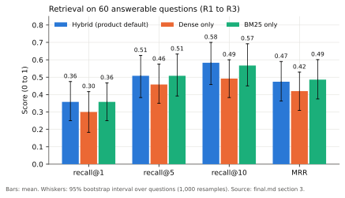
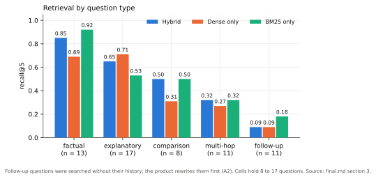
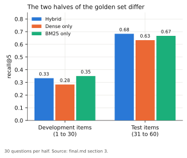
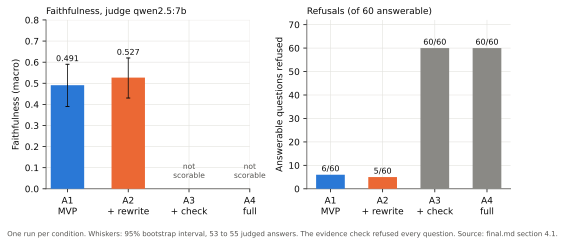
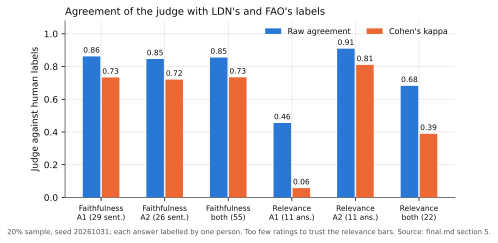
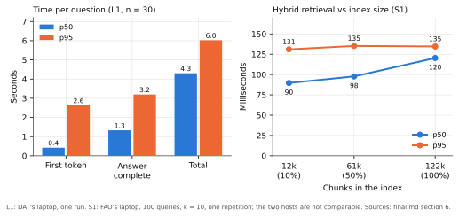

# 4. Evaluation

<!-- Draft (W8-D1-LDN-1, 2026-11-06). Page budget 6 (00-outline.md). Every number comes from
`evaluation/reports/final.md` (#196) and the run files it names; the section of `final.md` is
given where a table is shortened. Drafted with AI assistance (Claude); LDN is responsible for the
final text. The error analysis section summarises DAT's and FAO's reports and is for DAT to
check (W7-D4-DAT-1). -->

This chapter reports the evaluation of the system frozen in `evaluation/SNAPSHOT.md` (tag
`v0.6-rc`), in the order of the research questions of chapter 1:
- RQ1: retrieval (4.3);
- RQ2: query rewriting and the evidence check (4.4), with the check of the judge against people
  (4.5);
- RQ3: dropped (4.6).

Latency and the error analysis follow (4.7, 4.8), then the threats to validity (4.9).

Paragraphs marked **Measured** report a result with its sample size. Paragraphs marked
**Interpretation** say what the team thinks the result means; they are not measurements and may be
wrong. "Faithful" means supported by the cited passages, not true. The full tables are in
`evaluation/reports/final.md`; the plan is `evaluation/PLAN.md`.

## 4.1 Setup

**System under test.** All final runs use the frozen stack on one host (DAT's laptop, RTX 5060
Laptop 8 GB, Ollama 0.40.13):
- corpus: arXiv `cs.CL` titles and abstracts, Kaggle snapshot version 307, 121,860 documents,
  121,926 chunks (chapter 2);
- retrieval: hybrid (dense + BM25, reciprocal rank fusion) with the top 5 chunks as evidence
  (ADR 0009);
- generator `llama3.2:3b`, temperature 0, 512 answer tokens;
- judge `qwen2.5:7b`, temperature 0, a different model from the generator.

The code of the retrieval runs R1 to R3 and the answer runs A1 to A4 is commit `3a2b92d`. Each
run file records the golden-set hash, the index snapshot id and the models
(`evaluation/RUNS.md` section 7). Each condition was run once, and all runs had 0 errors.

**Golden set.** `evaluation/golden_set/golden.jsonl` has 65 English items. 60 are answerable and
used for retrieval and answer metrics; 5 are unanswerable (`gs-u01` to `gs-u05`) and used only for
the correct-refusal check. Items 1 to 30 are the development half and items 31 to 60 the test
half. One writer wrote most of the items from abstracts, and FAO checked part of them (4.9).

| Type | Answerable items | Dev | Test |
|---|---:|---:|---:|
| factual | 13 | 6 | 7 |
| explanatory | 17 | 10 | 7 |
| comparison | 8 | 4 | 4 |
| multi-hop | 11 | 5 | 6 |
| follow-up | 11 | 5 | 6 |
| **Total** | **60** | **30** | **30** |

**Metrics.** Recall@k, MRR, faithfulness, answer relevance, refusal rate and cited-document
recall are defined in `evaluation/PLAN.md` section 4. Intervals are 95% bootstrap intervals over
questions (1,000 resamples). Faithfulness is the share of checkable sentences supported by their
cited chunks. The macro average is taken per answer, the micro average per sentence. Refused
answers are not scored, and their number is reported next to the refusal rate.

## 4.2 Summary of results

| Question | Result (measured) | Reading (interpretation) |
|---|---|---|
| RQ1 | Hybrid recall@5 0.508 [0.383, 0.625] on 60 questions; dense 0.458; BM25 0.508. Hybrid beats dense at recall@10 (+0.092 [+0.025, +0.167]). | Hybrid is not better than BM25 here, and better than dense at recall@10 only. |
| RQ2 | Macro faithfulness 0.491 [0.39, 0.59] (MVP) and 0.527 [0.43, 0.62] (+rewrite). The evidence check refused 60/60 answerable questions. | No reliable effect of rewriting; the check as built is unusable with the 3B generator. |
| RQ3 | Not evaluated (ADR 0013). | Future work (chapter 6). |
| Judge | Faithfulness: 47 of 55 sentences agree with people (kappa 0.734). Relevance: 15 of 22 (kappa 0.389). | Faithfulness judge usable; relevance check too small. |

## 4.3 RQ1: retrieval

**Measured.** 60 answerable questions, the raw `question` field as the query, one run per
retriever (R1 to R3; `evaluation/runs/retrieval-final-compare.txt`):

| Metric | Hybrid | Dense | BM25 |
|---|---|---|---|
| recall@1 | 0.358 [0.250, 0.475] | 0.300 [0.183, 0.417] | 0.358 [0.250, 0.467] |
| recall@5 | 0.508 [0.383, 0.625] | 0.458 [0.350, 0.575] | 0.508 [0.392, 0.633] |
| recall@10 | 0.583 [0.458, 0.700] | 0.492 [0.383, 0.600] | 0.567 [0.450, 0.692] |
| MRR | 0.474 [0.363, 0.590] | 0.420 [0.309, 0.529] | 0.486 [0.375, 0.601] |

On the same 60 questions, hybrid against dense is +0.050 at recall@5 (interval
[−0.033, +0.133]) and +0.092 at recall@10 ([+0.025, +0.167]). The recall@10 difference is the only
one whose interval excludes 0. Hybrid against BM25 is 0.000 at recall@5 and +0.017 at recall@10,
and every interval includes 0.

*Figure 4.1. Recall and MRR of the three retrievers (R1 to R3), with 95% intervals.*

By question type (hybrid recall@5, n in brackets): factual 0.85 (13), explanatory 0.65 (17),
comparison 0.50 (8), multi-hop 0.32 (11), follow-up 0.09 (11). The cells are small, so the
differences between types are descriptive.

*Figure 4.2. Recall@5 by question type.*

**Development and test halves differ.** Hybrid recall@5 is 0.333 on the 30 development items and
0.683 on the 30 test items; dense is 0.283 and 0.633, BM25 0.350 and 0.667. The order of the three
retrievers is the same on both halves (hybrid and BM25 close, dense lowest), but the level of the
60-item average depends on which half is taken. The plan says to report both halves, and they are
reported here. The reason for the difference is not established.

*Figure 4.3. Recall@5 on the development and the test items.*

**Interpretation.**
- The expectation that hybrid is at least as good as the better single retriever holds: it ties
  BM25. The expectation that BM25 is competitive only on exact technical terms is too weak,
  because BM25 matches hybrid on this set. The questions were written from abstracts, which can
  favour keyword matching (4.9).
- The follow-up figure (0.09) does not measure the product. The agent rewrites a follow-up into a
  standalone query before searching, and R1 to R3 search with the last turn only. On answered
  follow-up items, the share of relevant papers among the sources was 0.125 without the rewrite
  (A1, n = 8) and 0.44 with it (A2, n = 9). The two sets of answered items differ and n is small,
  so this is an indication, not a measured effect.

## 4.4 RQ2: query rewriting and the evidence check

**Measured.** 60 answerable and 5 unanswerable questions, one run per condition. A1 is the MVP
(`AGENT_REWRITE=off`, `AGENT_SELF_CHECK=off`), A2 adds the rewrite (the product configuration), A3
adds the evidence check, and A4 has both.

| Measure | A1 MVP | A2 +rewrite | A3 +check | A4 full |
|---|---|---|---|---|
| Answers judged | 54 | 55 | 0 | 0 |
| Answerable questions refused | 6/60 | 5/60 | 60/60 | 60/60 |
| Unanswerable questions refused | 4/5 | 4/5 | 5/5 | 5/5 |
| Faithfulness, macro [95% CI] | 0.491 [0.39, 0.59] | 0.527 [0.43, 0.62] | not scorable | not scorable |
| Faithfulness, micro | 0.408 (62/152) | 0.441 (67/152) | - | - |
| Cited-document recall [95% CI] | 0.398 [0.27, 0.53] | 0.427 [0.30, 0.55] | - | - |
| Relevance (1 to 3), judge, mean [95% CI] | 2.31 [2.11, 2.52] | 2.44 [2.24, 2.62] | - | - |

*Figure 4.4. Macro faithfulness and over-refusals of the four agent conditions.*

Faithfulness by question type is the same in A1 and A2 for every type except follow-up, because the
rewrite changes only follow-up turns: follow-up 0.48 (n = 8) for A1 and 0.70 (n = 9) for A2.

**Rewriting.** On the 53 answers judged in both runs, the paired faithfulness difference is
+0.031 [−0.009, 0.082]: A2 is better on 4 answers, worse on 1 and equal on 48. The interval
includes 0. The sets of answered items differ (A2 refused `gs-018`, which A1 answered; A1 refused
`gs-022` and `gs-060`, which A2 answered).

**Evidence check.** With `AGENT_SELF_CHECK=on`, all 60 answerable and all 5 unanswerable questions
were refused, with and without the rewrite. The earlier ablation on the development items did the
same (30 of 30 answerable refused; `evaluation/reports/ablations-v1.md`). A3 and A4 cannot be
scored.

**Where faithfulness is lost** (A2; `evaluation/reports/answer-errors-w7.md`; causes assigned by
rule from the run fields, no case re-read by a person):
- 64 of the 85 sentences labelled not supported (75%) carry no citation marker.
- Sentences that cite a chunk are supported 67 times out of 88 (0.76).
- Of the 20 worst answers, 12 are "missing citations" (a relevant paper was among the sources in
  all 12), 5 are over-refusals and 3 are retrieval misses.

**Interpretation.**
- The direction of the rewriting result is the one expected, but one run per condition, and a gain
  that rests on 8 and 9 answers, do not support a claim of an effect.
- The evidence check as built, with `llama3.2:3b`, answers NO whatever the sources. The runs cannot
  say whether the cause is the model size, the prompt or the 8-token limit on the reply, because
  the raw reply was not stored. The result supports keeping the check off in the product.
- Part of the low faithfulness is a citation-format failure of the 3B generator: it writes
  sentences without `[n]` that may be right or may come from its own knowledge. These runs cannot
  separate the two. The report keeps the all-sentence rate as the headline, because a sentence
  without a citation cannot be checked.
- Unanswerable questions: 4 of 5 were refused in A1 and A2. `gs-u05` (the parameter count of
  Gemini) was answered, and three retrieved abstracts mention Gemini near the word "parameter"
  without giving its size. With 5 items, each is 20 points.

## 4.5 The judge against human labels

**Measured.** LDN and FAO labelled every sentence, and rated every answer, of a 20% sample of the
answers that enter the metrics (seed 20261031): 11 answers each for A1 and A2, split in two halves
between them. Each annotator used the written procedure of `PLAN.md` and did not see the judge
output. LDN's and FAO's files are in `evaluation/pilot/w7-sample/`.

| | n | Raw agreement | Cohen's kappa |
|---|---:|---:|---:|
| Faithfulness, A1 (sentences) | 29 | 25/29 = 0.862 | 0.733 |
| Faithfulness, A2 (sentences) | 26 | 22/26 = 0.846 | 0.720 |
| **Faithfulness, A1 + A2** | **55** | **47/55 = 0.855** | **0.734** |
| Relevance, A1 (answers) | 11 | 5/11 = 0.455 | 0.057 |
| Relevance, A2 (answers) | 11 | 10/11 = 0.909 | 0.810 |
| **Relevance, A1 + A2** | **22** | **15/22 = 0.682** | **0.389** (weighted 0.285) |

On the same 11 answers per run, the judge's macro faithfulness was higher than the people's
(A1 0.500 against 0.394, A2 0.583 against 0.523).

**Interpretation.**
- The faithfulness judge agrees with the annotators on about 85% of sentences. The faithfulness
  numbers of 4.4 may be a little optimistic. With 11 answers per run, the difference is within
  noise.
- The relevance judge agrees poorly in A1 and well in A2. Eleven ratings per run are too few to
  say which reading is closer to the rule, so the relevance means carry this caveat.
- With one annotator per sentence, there is no human-human agreement. Differences between the two
  annotators' rows cannot be told apart from differences between the two halves of the sample.

*Figure 4.5. Agreement of the judge with the human labels.*

## 4.6 RQ3 was dropped

RQ3 asked whether users find the suggested follow-up questions useful and click them. The only
planned evidence was a user study with four to six participants. The study was cancelled on
3 November, before the first session, and ADR 0013 records the decision. No session was held and
no study data exists, so this report makes no claim about the usefulness of the follow-up
suggestions. They stay in the product (chapter 5). The rating buttons and `POST /feedback` stay as
well, and are not used for evaluation.

## 4.7 Efficiency

**Measured.** Latency on the first 30 golden questions (L1, one run, DAT's laptop,
`QDRANT_URL=127.0.0.1`; `docs/runbooks/performance.md`):

| Time (ms) | p50 | p95 | max |
|---|---:|---:|---:|
| First token | 422 | 2,632 | 5,016 |
| Answer complete | 1,328 | 3,196 | - |
| Total | 4,304 | 6,025 | 9,125 |

Retrieval takes 31 ms at the median (p95 47 ms). The follow-up suggestions arrive about 2.9 s after
the answer is on screen. With `localhost` instead of `127.0.0.1` on Windows, 6 of 30 retrievals
took about 2 s, so all later runs use `127.0.0.1`. L1 ran before the final runs and was not
repeated; the one change since then (a regex) does not touch the timed steps.

*Figure 4.6. Time per question (L1) and hybrid retrieval latency against index size (S1).*

Index scaling (S1, FAO's laptop, 100 queries, k = 10, exact search;
`pipelines/reports/scaling.md`; chapter 2):

| Size | Chunks | Hybrid latency p50 / p95 (ms) |
|---|---:|---|
| 10% | 12,162 | 89.6 / 131.0 |
| 50% | 61,067 | 97.7 / 135.2 |
| 100% | 121,926 | 120.4 / 134.6 |

**Interpretation.** Answer generation dominates the response time; the index is not the bottleneck
at this size. The scaling run has three sizes and one repetition on one laptop, and says nothing
about much larger corpora. The two measurements come from different hosts and are not comparable
with each other.

## 4.8 Error analysis

The detailed analyses are `evaluation/reports/retrieval-errors-w7.md` (FAO, retrieval) and
`evaluation/reports/answer-errors-w7.md` (DAT, answers). The main findings:

1. **Missing citations** are the largest single cause of low faithfulness (12 of the 20 worst A2
   answers), and in all of them the right document was retrieved.
2. **Follow-up questions searched without their history** (10 of hybrid's 32 missed questions) and
   **vocabulary mismatch**, where the question uses everyday words and the abstract uses the
   technical term (7), are the two largest causes of retrieval misses. A better ranker does not
   solve either; both need a better query.
3. **Crowded topics** (7 misses), where other papers rank above the relevant one, and
   **retriever-dependent misses** (6), found by one single retriever but lost in the fusion.
4. **Near misses.** Six of hybrid's 32 misses have the relevant paper at ranks 6 to 10, which never
   reach the answer because only the top 5 chunks are shown.
5. **Multi-hop and comparison questions** need two papers, so one missing paper counts as a miss.
   Question decomposition, which targeted them, was cut (ADR 0010).
6. **The evidence check refuses everything** with the 3B generator (4.4).

No relevant paper was missing from the index: all 78 relevant papers are in the chunks and in
Qdrant, and none is split across chunks.

## 4.9 Threats to validity and limitations

- **Small sample.** 60 answerable questions, cells of 8 to 17 per type, 11 answers per run in the
  manual sample. One question moves a recall figure by 1.7 points. No claim of significance is made
  for small differences.
- **The two halves differ.** Retrieval is better on the test half and faithfulness is higher on the
  development half (A2 macro 0.576 on dev, 0.487 on test), so the 60-item average hides two
  opposite directions. The reason is not established.
- **One run per condition.** The run-to-run variation of the LLM was not measured.
- **Golden set.** Most items were written by one person from abstracts, which can favour keyword
  matching. Only the documents the writer found are labelled, so recall and MRR are conservative.
- **Prior knowledge.** A correct sentence from the generator's memory counts as unsupported if its
  citation does not say it. A closed-book check was planned as optional and was not run.
- **Judge and annotators.** The judge is a 7B model, checked on 55 sentences and 22 ratings. Each
  sample answer was labelled by one person, so human-human agreement is unknown. DAT did not
  annotate, because DAT built the agent.
- **Scope of the corpus and system.** Titles and abstracts of one snapshot. Reranking and question
  decomposition were cut (ADR 0010). Reading the full text of one paper on demand (ADR 0012), the
  search plans and scheduled ingestion came after these runs, and nothing here measures them.
- **Hosts.** Answer runs and R1 to R3 ran on DAT's laptop, the scaling measurements on FAO's.
  Timings are not comparable between hosts, and the generator ran locally, so the earlier Kaggle
  numbers (ADR 0006) are not comparable answer by answer.
- **No user study.** RQ3 is not evaluated (4.6).

Provenance: the agreement numbers, the paired differences and the tables by split and by type were
computed from the run files and the label files with a script that is not in the repository
(`final.md`, appendix).
