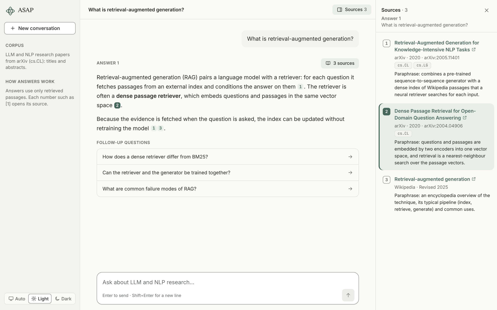
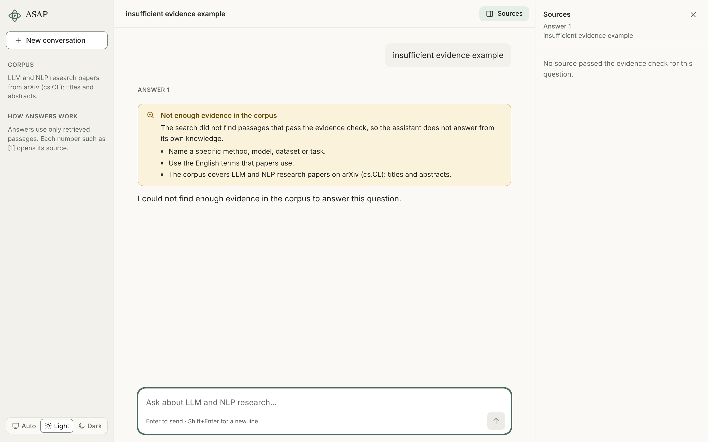
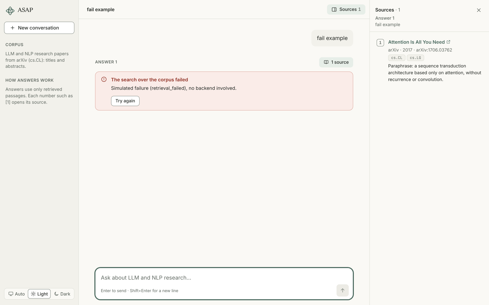

# 5. Interface

<!-- Draft (W8-D1-LDN-1, 2026-11-06). Page budget 2 (00-outline.md). Sources: `frontend/` on `main`
at `c56cf1d`, `frontend/docs/design-system/`, `docs/contracts/api.openapi.yaml` (0.3.0), ADR 0004,
`docs/demo/v0.4-mvp/`. Drafted with AI assistance (Claude); LDN is responsible for the final text.
The interface was checked by hand and with unit tests of its logic. No user rated it (chapter 4,
4.6), so this chapter describes the design and does not report a result. -->

The interface is a single-page chat application in `frontend/`. It sends a question to the backend,
shows the evidence, the answer and the follow-up questions as the backend streams them, and keeps
the cited passages one click away. It was designed so that a reader can check an answer against its
sources, and so that a failure and a refusal are never mistaken for an answer.

Figure 5.1. The chat screen after one question: the answer with numbered citations, the sources panel
with the second source highlighted, and the suggested follow-up questions.

Figure 5.2. The "not enough evidence" state (cropped): a warning callout, not an error (5.5).

Figure 5.3. The error state (cropped), with the "Try again" button (5.5).

All three screens come from the showcase page (`npm run showcase`, 5.7), which renders the same
`ChatWorkspace` component with illustrative data and a simulated stream, and no backend. The paper
titles and identifiers are real; the answer texts are written by hand and the source excerpts are
paraphrases. The figures show the layout, not the output of the agent, and the error text in
Figure 5.3 is simulated. The earlier recordings in `docs/demo/v0.4-mvp/` show the first version; the
product name and the header changed after them.

## 5.1 Technology

ADR 0004 chose React, Vite and TypeScript as a static single-page app, without Next.js. The reasons
were fine control of streaming and layout, and a typed link to the API contract. The chosen
toolchain runs on Node.js 22. The app has five runtime dependencies: React, React DOM and three
font packages (`frontend/package.json`).

Two choices in ADR 0004 were not followed. Tailwind CSS and shadcn/ui were not used: the project
has its own small design system (5.7). `react-markdown` was not used either: answers go through a
parser of our own (`src/markdown.ts`) that builds React elements and never inserts HTML, so no
markup in an answer can be interpreted by the browser. The API types in `src/types.ts` are written
by hand to follow the contract rather than generated from it.

## 5.2 The screen

The screen has three parts (`src/chat/ChatWorkspace.tsx`):
- **Sidebar.** The product name (ASAP), "New conversation", two short facts (the corpus, and that
  answers use only retrieved passages) and the theme switch (system, light, dark).
- **Conversation.** A reading column of at most 760 px. Questions and answers sit on the page, not
  in chat bubbles. An empty conversation offers three example questions, which fill the input
  box without sending it.
- **Sources panel.** The passages behind one answer, on the right.

Below 1280 px the sidebar becomes a drawer, and below 1024 px the sources panel does too. Enter
sends a question and Shift+Enter starts a new line. Enter does nothing while an input method is
composing text, so that the confirming key of a Vietnamese or Japanese keyboard does not send a
half-written question (`src/ui/composerKeys.ts`).

## 5.3 One question, step by step

The backend answers `POST /chat` with a stream of events (chapter 3, 3.2), and the screen shows
each event as it arrives (`src/chat/useChat.ts`, `src/api.ts`):
1. **Searching.** After the request is sent, the answer shows "Searching the corpus...".
2. **Sources.** The `sources` event comes first. The panel fills with the retrieved passages and the
   answer header shows the number of sources, while the answer is still being written.
3. **Answer.** The `token` events stream the text, with the label "Writing the answer...". When the
   user sends a question, the view scrolls that question into view once and does not follow the
   stream, so a reader of an earlier answer is not pulled away.
4. **Follow-ups.** The `followups` event adds up to four suggested questions under the finished
   answer.
5. **Done.** The `done` event ends the answer, and its `message_id` is kept for feedback.

One `session_id` belongs to one conversation, and "New conversation" starts a new one.

## 5.4 Citations and sources

The answer cites a passage with a number such as `[1]`, which is the position of the passage in the
list of sources of the same answer. Each number is a button. A click opens the sources panel,
scrolls to that source and highlights it. A number that has no matching source is shown, but is not
a button.

A source shows its title (a link to the paper when there is one), kind, date, identifier,
categories and an excerpt that can be expanded. It does not show the retrieval score: scores of the
dense and the BM25 retriever have no common scale, and the score threshold is not calibrated
(chapter 3). Fields the backend did not send are left out. A source the answer did not cite is
marked "Retrieved, not cited in this answer", so a reader can tell the evidence that was shown from
the evidence that was used.

The interface displays a citation. It does not check that the cited passage supports the sentence
next to it. Chapter 4 shows that this matters: most unsupported sentences have no citation marker,
and the interface cannot flag a sentence that lacks one.

## 5.5 Refusals and failures

The interface separates three outcomes that look alike in a plain chat window:
- **An answer.** Text with citations.
- **Not enough evidence.** The request worked, but the agent refused to answer. A warning callout
  says so, states that the assistant does not answer from its own knowledge, and gives three
  suggestions: name a specific method, model, dataset or task; use the English terms that papers
  use; and a reminder that the corpus is titles and abstracts of `cs.CL` papers
  (`InsufficientEvidenceState.tsx`). It is shown as an answer state, not as an error. Whether a
  refusal is correct is a matter for the agent (chapter 4, 4.4); the interface only reports it.
- **A failure.** An error callout titled by the code of the `error` event (the answer service is
  unavailable, the search failed, the answer took too long, something went wrong), or "Could not
  reach the server" when the request never reached the backend. If part of the answer had arrived,
  that text stays on screen and the title says the answer stopped early. A "Try again" button
  resends the question.

## 5.6 Follow-ups and feedback

A click on a suggested question sends it at once as the next question of the same conversation.
The suggestions stay with the latest answer that has some, and are disabled while another answer is
being written.

Under a finished answer, two thumbs ask "Was this answer useful?". A choice is shown as pressed and
can be changed. Both the thumbs and the clicks on suggestions are sent to `POST /feedback`, which
appends one line to a log file (`docs/contracts/api.openapi.yaml`, 0.3.0). The rating buttons and
the log are part of the product. They were meant to feed the user study, which was cancelled, so
the log is not used for any result in this report (chapter 4, 4.6).

## 5.7 Design system and accessibility

The look comes from a small design system approved on 2026-10-21 (`frontend/docs/design-system/`):
tokens for light and dark themes, three fonts (Newsreader for headings, Inter for text and answers,
JetBrains Mono for code), and the components in `frontend/src/ui/`. A showcase page
(`npm run showcase`) renders the same chat screen with fixture data and no backend, so the states
of 5.5 can be inspected without making them happen.

Accessibility measures in the code:
- a test fails if a colour pair used by a component falls below the WCAG AA contrast ratio in the
  light or the dark theme (`src/ui/contrast.test.ts`);
- the live status line announces searching, answering and errors to screen readers;
- the answer is marked as busy while it streams;
- every thumb and citation button has a text label;
- animation is reduced when the system asks for it.

## 5.8 Testing, and what was not tested

`npm test` runs 70 automated tests, all passing on `main` at `c56cf1d` in a Linux session. They
cover the event-stream client, the Markdown parser, the rules of the chat state, feedback
messages, the health check, citation and source logic, the composer key rule and the colour
contrast. The screens themselves were checked by hand. No screen-reader test, no test on a phone
and no automated end-to-end test was run, and no user rated the interface, because the user study
was cancelled (ADR 0013). A single manual session of 12 turns on 2026-10-30 is an illustration of
how the product behaves, not a measurement (chapter 3).

## 5.9 Limits

- The interface shows the citations the agent wrote; it does not verify them (5.4).
- Sources are abstracts, so a "passage" is an excerpt of an abstract, and a citation does not jump
  to a place inside a paper.
- Only the theme choice is remembered between visits (in the browser). Conversations are not
  saved, and the sidebar has no history.
- The public demo on the Hugging Face Space uses a hosted model and a quota of about two
  questions per minute in total and three per visitor, so its answers and speed do not describe the
  evaluated system (`README.md`; chapter 3).
- The interface is in English only, as is the corpus.
