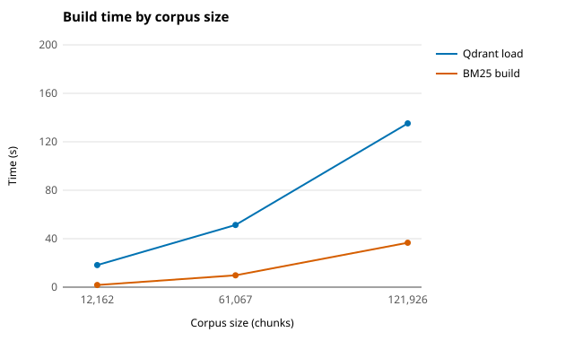

# Scaling measurements

W6-D2-FAO-1, the "big data" evidence for the report. Measured on 2026-10-22 (D09, evening in
UTC+7) with `pipelines/scripts/scaling.py` (#96, at `39ad9b2`) on FAO's laptop.
The numbers below are the table the script printed at the end of the run; `scaling.csv` next to
this file holds the same values. The script's own JSON files (`scaling.json` and one
`profile-<pct>pct.json` per size) are kept on the laptop, in `data/reports/scaling/`, as `data/`
is not in git.

## 1. Method

Three sizes of the same index, all from the Week 3 vectors (`BAAI/bge-small-en-v1.5`, 384
dimensions, ADR 0007), so nothing was embedded again (the replan of W6-D2-FAO-1):

- **Subsets:** `load --fraction F` keeps a document when `sha256(doc_id)`, read as a number in
  [0, 1), is below F, with all its chunks. The subsets are fixed, spread over all years, and
  nested: the 10% subset is inside the 50% one, which is inside the full index.
- **Qdrant:** each subset is loaded into its own collection (`scitech_chunks_10pct`,
  `scitech_chunks_50pct`) next to the full `scitech_chunks`.
- **BM25:** each subset's chunks are written out and indexed with
  `python -m scitech_agent.retrieval.keyword build`.
- **Latency, disk and memory:** before each size, Qdrant is restarted
  (`docker compose restart qdrant`). Then `pipelines/scripts/index_profile.py` (W3-D5-FAO-1, #68)
  runs 100 queries (the 37 golden query texts, then chunk titles with seed 0) at k = 10 against
  that size's collection and BM25 index, after 5 untimed warm-up searches per retriever. Every
  size gets the same 100 queries. A time is the whole `search(query, k)` call in Python: for
  dense and hybrid it includes embedding the query on the CPU and the HTTP request to Qdrant.
  Search is exact (the default since #101).

| Item | Value |
|---|---|
| Machine | FAO's laptop: Windows 11, 8 logical CPUs, 15.8 GiB RAM, Python 3.14.3, no GPU used |
| Qdrant | 1.19.2 in Docker (`docker compose`), on the same laptop |
| Full index | `scitech_chunks/bge-small-en-v1.5/chunked-2026-10-17T05:19:12/embedded-2026-10-17T06:40:37` |
| Subset ids | the same, ending in `/subset-0.1` and `/subset-0.5` |

## 2. Results

| Size | Documents | Chunks | Load (s) | BM25 build (s) | BM25 on disk (MiB) |
|---|---:|---:|---:|---:|---:|
| 10% | 12,155 | 12,162 | 18.2 | 1.8 | 18.2 |
| 50% | 61,039 | 61,067 | 51.3 | 9.8 | 89.4 |
| 100% | 121,860 | 121,926 | 135.2 | 36.7 | 177.2 |

Query latency in ms, 100 queries, k = 10:

| Size | dense p50 / p95 / max | bm25 p50 / p95 / max | hybrid p50 / p95 / max |
|---|---:|---:|---:|
| 10% | 80.61 / 116.06 / 192.17 | 1.16 / 2.46 / 3.13 | 89.55 / 131.02 / 136.72 |
| 50% | 84.33 / 92.84 / 94.46 | 4.82 / 9.23 / 10.24 | 97.71 / 135.22 / 147.6 |
| 100% | 93.39 / 101.03 / 103.86 | 8.13 / 15.54 / 17.16 | 120.36 / 134.63 / 143.68 |

No query returned zero hits at any size.

Qdrant on disk and in memory:

| Size | Qdrant collection on disk (MiB) | Raw vectors (MiB) | Container memory after the restart (MiB) |
|---|---:|---:|---:|
| 10% | 465.0 | 17.8 | 224.4 |
| 50% | 412.7 | 89.5 | 106.8 |
| 100% | 609.9 | 178.6 | 106.7 |

- Raw vectors = chunks x 384 x 4 bytes (float32), computed, not measured.
- All three collections together took 1,487.5 MiB of Qdrant storage. Each collection had 4
  segments.

Where the 100% numbers come from:
- The 100% load time (135.2 s) and BM25 build time (36.7 s) are from the full load and build of
  2026-10-21 (#91, `index_profile.md`), not from this run. The subset loads ran today.
- The 100% latency, disk and memory rows were measured in this run.

Charts of the same numbers (W7-D2-FAO-1), drawn from `scaling.csv` by
`python pipelines/scripts/scaling_charts.py`. The x axis is the corpus size in chunks; solid lines
are p50, dashed lines p95.

### 2.1 Vector search alone, with pre-computed query vectors

Measured on 2026-10-27 (D13) on the same laptop and Qdrant, against the same three collections.
The script was `pipelines/scripts/vector_search_timing.py` (W7-D2-FAO-1, DAT's note 1 on #96, at
`990b2fa`).
- **Queries:** the same 100 queries as above were embedded once, before any search. Embedding
  alone took p50 38.25 ms and p95 49.45 ms (the first run of the day gave p50 62.76 ms).
- **Searches:** then `QdrantStore.search` ran with those vectors at k = 10, with 5 untimed
  warm-up searches and 3 passes over the 100 vectors, so 300 timed searches per cell.
- **Two times per search:**
  - "End to end" is the whole call in Python.
  - "Qdrant" is the `time` field of Qdrant's answer: the search inside Qdrant, without the HTTP
    round trip.
- **Modes:**
  - exact (the default, #101);
  - HNSW;
  - exact without gzip, and that again with TCP_NODELAY. These two check #128.

The tables are copied from the script's printed output; its JSON stays on the laptop in
`data/reports/scaling/vector_search.json`.

Qdrant's own time per search, p50 / p95 / max (ms):

| Size | Points | exact | HNSW | exact, no gzip | exact, no gzip, nodelay |
|---|---:|---:|---:|---:|---:|
| 10% | 12,162 | 2.03 / 2.58 / 3.63 | 2.1 / 2.86 / 4.13 | 2.04 / 2.48 / 3.08 | 2.16 / 5.57 / 10.46 |
| 50% | 61,067 | 7.96 / 14.49 / 20.47 | 1.62 / 1.9 / 2.2 | 7.46 / 8.6 / 12.04 | 7.44 / 8.31 / 10.06 |
| 100% | 121,926 | 14.39 / 17.22 / 22.35 | 2.56 / 3.18 / 4.24 | 14.1 / 15.68 / 17.93 | 14.15 / 16.18 / 17.76 |

End to end, p50 / p95 / max (ms), and the share of the exact top 10 that HNSW also returned:

| Size | exact | HNSW | exact, no gzip | exact, no gzip, nodelay | HNSW top 10 shared with exact |
|---|---:|---:|---:|---:|---:|
| 10% | 47.98 / 48.97 / 51.96 | 47.98 / 48.97 / 51.8 | 48.01 / 48.99 / 52.67 | 48.16 / 57.96 / 60.57 | 100.0% |
| 50% | 53.25 / 65.26 / 73.96 | 47.96 / 48.85 / 52.53 | 52.04 / 54.51 / 58.24 | 52.0 / 53.29 / 55.47 | 97.9% |
| 100% | 60.42 / 64.19 / 71.02 | 47.98 / 48.85 / 49.68 | 59.94 / 62.25 / 64.66 | 60.03 / 62.56 / 64.98 | 99.1% |

## 3. What the numbers say

- **BM25 latency grows with the corpus:** p50 1.2 ms, 4.8 ms, 8.1 ms at 10%, 50% and 100%. That
  is about 0.6 ms per 10,000 chunks. BM25 build time and size on disk grow in step with the
  chunks (1.8 s, 9.8 s, 36.7 s; 18.2, 89.4, 177.2 MiB).
- **Exact vector search grows linearly; HNSW stays flat (section 2.1).**
  - Inside Qdrant, exact search took p50 2.0 ms, 8.0 ms and 14.4 ms at 12,162, 61,067 and
    121,926 points. That is about 1.1 ms per 10,000 points.
  - At that slope, a corpus of a million chunks would take roughly 110 ms per exact search. This
    is an extrapolation from three points, not a measurement.
  - HNSW took 1.6 to 2.6 ms at every size. It returned 97.9% to 100% of the exact top 10.
- **Each search also carries a fixed ~46 ms round trip on this laptop.** End to end minus
  Qdrant's own time is 45.3 to 46.3 ms in every mode and at every size.
  - Turning gzip off or setting TCP_NODELAY does not change it, so on Windows the gzip delay of
    #128 is not the cause.
  - That the cost comes from Docker Desktop's port forwarding between Windows and the
    container is a guess, not a measurement.
  - So a dense search here is about 38 to 63 ms of query embedding, about 46 ms of round trip,
    and 2 to 14 ms of search.
- **Dense latency barely changes:** p50 80.6 ms at 10% and 93.4 ms at 100%. Most of a dense
  search is embedding the query on the CPU and the round trip to Qdrant, and neither depends on
  the corpus size.
  - The 13 ms difference is about the size of the run-to-run variation. On 2026-10-21, the same
    full collection and queries gave a p50 of 82.5 ms (`index_profile.md`), 11 ms less than
    today.
  - The 116 ms p95 at 10% comes from a few slow queries (max 192 ms). It was the first profile
    of the run, so a cold start is a likely cause (inferred).
  - Exact search costs grow linearly with the number of points. Section 2.1 measures the slope
    inside Qdrant: about 1.1 ms per 10,000 points. At a million chunks HNSW search would be
    needed, and its recall would have to be re-checked (#87). On this corpus HNSW shared 97.9% to
    100% of the exact top 10.
- **Hybrid** follows dense plus BM25: p50 89.6 ms, 97.7 ms, 120.4 ms; p95 about 131 to 135 ms at
  every size.
- **Load time** is not linear in the subset size, because a subset load still reads all 15
  vector parts and skips the other documents: 18.2 s for 12,162 points (668 points/s) and
  51.3 s for 61,067 points (1,190 points/s). The full load of 2026-10-21 ran at 902 points/s.
- **All three sizes are far below the LLM's time to first token** (0.44 s on the Kaggle server,
  #91). Retrieval is not the bottleneck of a chat turn at the corpus size we have.

## 4. Limits

- **Disk size of a fresh collection is mostly fixed overhead.** The 10% collection takes more
  disk (465.0 MiB) than the 50% one (412.7 MiB), although it holds a fifth of the vectors. Raw
  vectors are only 17.8 MiB of it. The likely cause (inferred, not measured) is space that
  Qdrant reserves per segment, such as the write-ahead log and pre-allocated vector storage,
  which the optimiser had not compacted yet. Compare sizes by the raw vectors, not by this
  column.
- **Memory is the whole container's, not one collection's.** All three collections were in the
  same Qdrant, so the memory column is not a per-size measurement. The first reading
  (224.4 MiB) was taken right after the two subset loads; the next two were about 107 MiB each.
- **One machine, one run of 100 queries per size.** Read differences of a few milliseconds as
  noise.
- **Sequential queries only.** Latency under several users at once is not measured.
- **Load seconds are an upper bound for the subsets.** They include reading the vector parts of
  the documents that were skipped.
